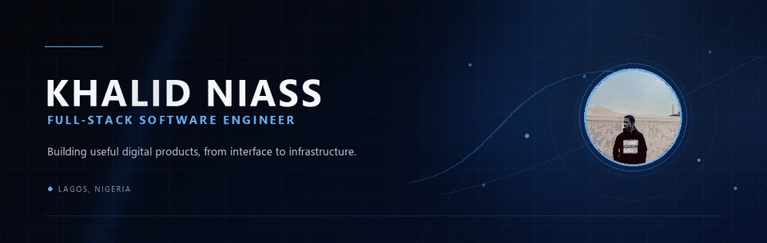

  

  

  <a href="https://github.com/khalidNiass">GitHub: @khalidNiass</a> &nbsp; / &nbsp; Lagos, Nigeria &nbsp; / &nbsp; Open to freelance work

## About

I'm a Lagos-based Full-Stack Software Engineer building useful digital products: thoughtful interfaces backed by reliable APIs, well-designed data models, and real-time experiences. I care about maintainable architecture, security, and a clear end-to-end user experience. I also teach frontend development.

## Engineering toolkit

  

- **Languages:** JavaScript, TypeScript, SQL
- **Frontend:** React, Tailwind CSS, Vite, interface architecture
- **Backend:** Node.js, Express.js, REST APIs, Socket.IO
- **Data:** PostgreSQL, Supabase, relational schema design
- **APIs and integrations:** REST, real-time communication, Flutterwave payments
- **Tools and delivery:** Git, GitHub, Vercel, deployment and maintenance

## Selected work

### WHOTHub

A Nigerian online WHOT platform for browser-based multiplayer play. The live experience includes real-time 1v1 matches, private friend challenges, bot games, and tournaments.

**Stack:** React, TypeScript, Node.js, Express.js, Socket.IO, Supabase PostgreSQL, and Flutterwave.

**Play:** [whothub.com](https://whothub.com/) &nbsp; / &nbsp; **Source:** [Private repository (access restricted)](https://github.com/khalidNiass/WHOTHub).

### STJ Family Homes

A hospitality and accommodation management platform with public-facing pages and dedicated customer, staff, and owner dashboards.

**Stack:** React, TypeScript, Tailwind CSS, and Vite.

**Source:** [Private repository (access restricted)](https://github.com/khalidNiass/STJ-family-homes). A public demo is not currently available.

### More public work

- [LumenPulse](https://github.com/khalidNiass/Lumenpulse) / [Live site](https://lumenpulse.vercel.app/) - Decentralized crypto news on Stellar.
- [BorderBus](https://github.com/khalidNiass/BorderBus) - Bus booking for inter-state and international travel.
- [Browse all public repositories](https://github.com/khalidNiass?tab=repositories)

## How I contribute

- Full-stack application development and frontend engineering
- Backend API development, database design, and integration
- Payment gateway integration and real-time application features
- Application deployment, maintenance, and technical instruction

## Current focus

Building WHOTHub and STJ Family Homes, while deepening my practice in real-time product experiences, payment integrations, and maintainable backend architecture.

## GitHub activity

  
  

## Let's connect

Open to freelance opportunities, software collaborations, and technical discussions. Reach me on [GitHub](https://github.com/khalidNiass).

